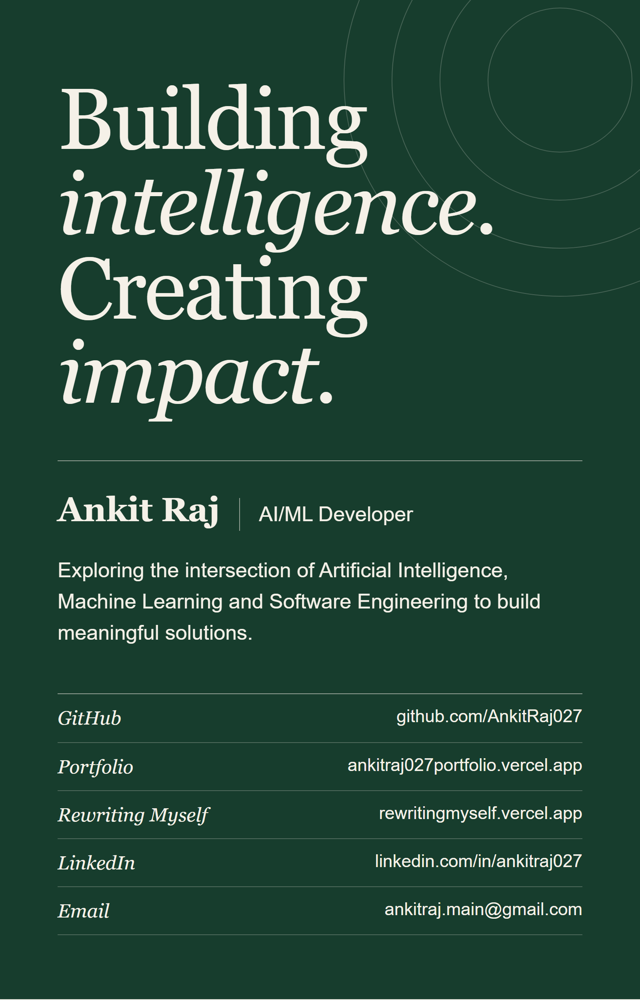
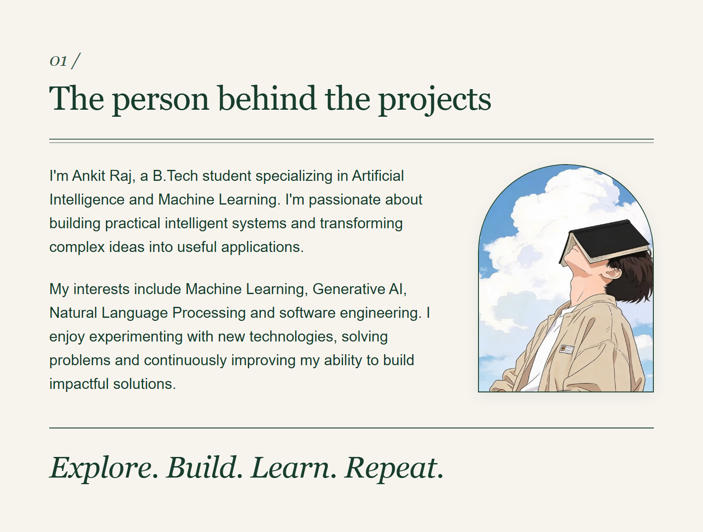
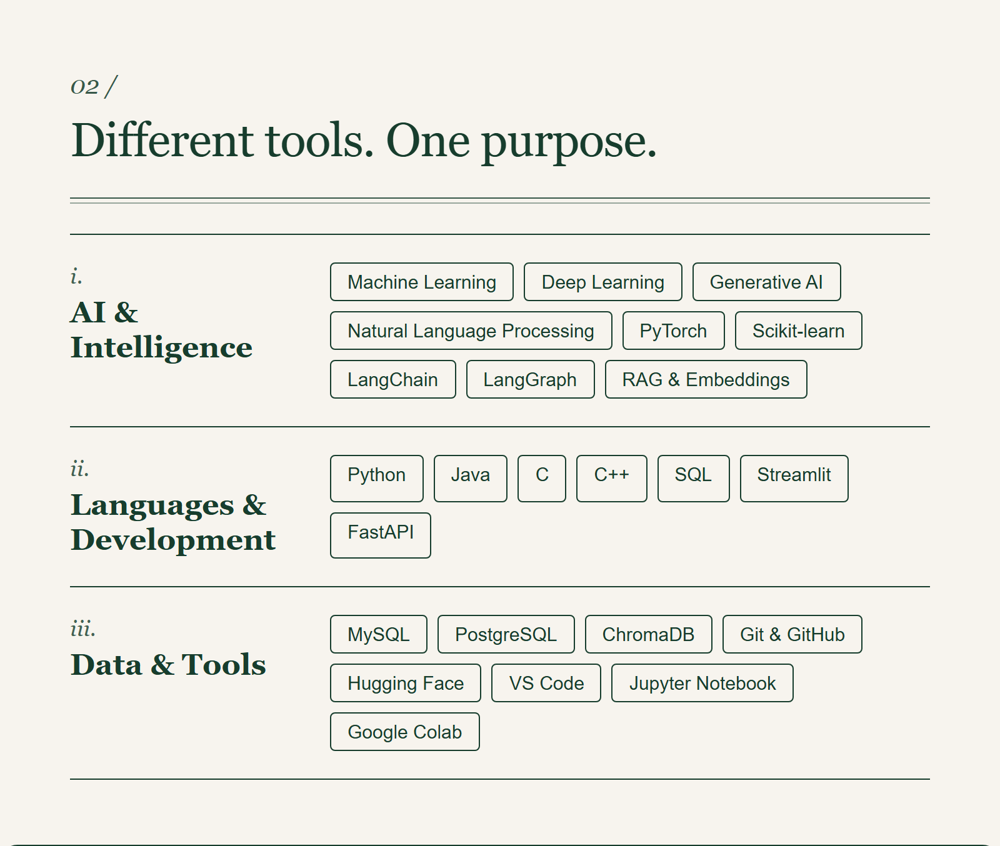
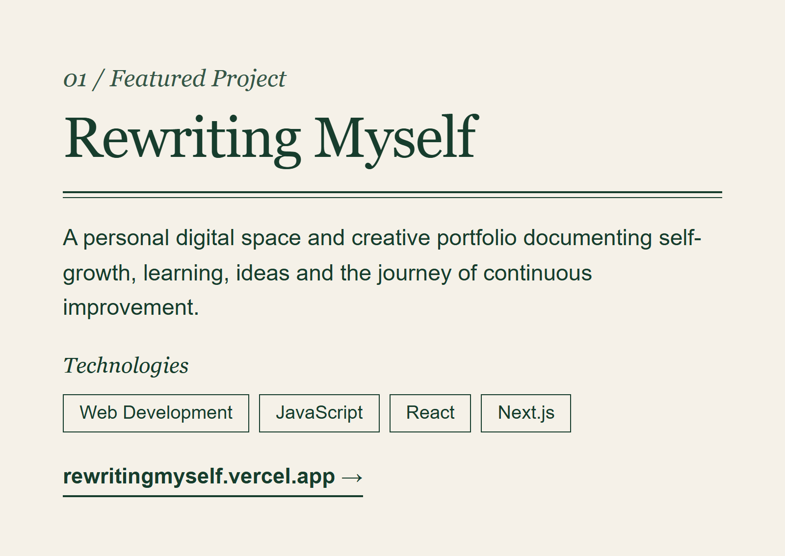
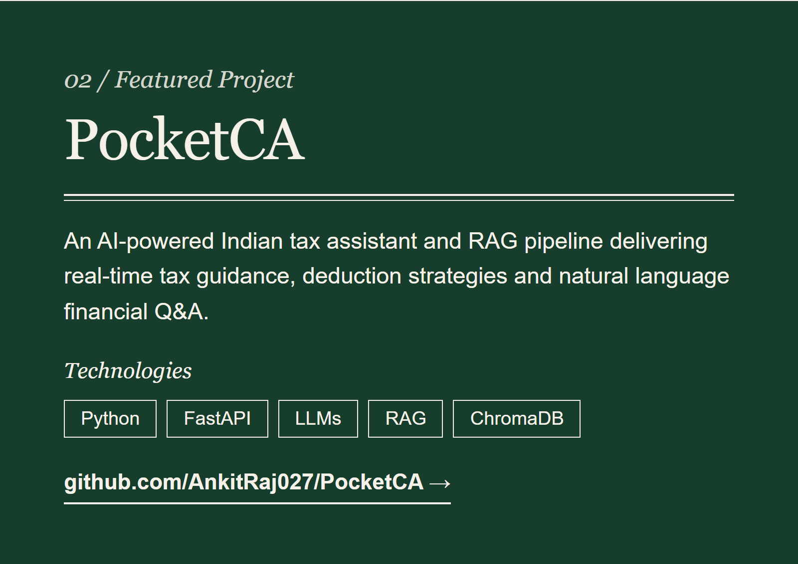
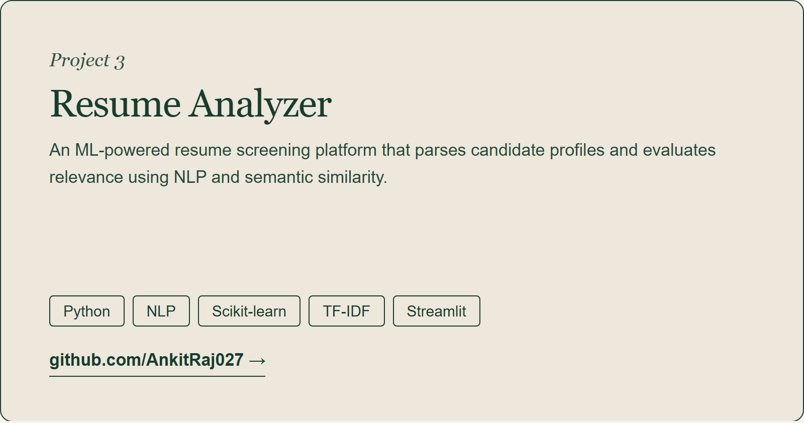

<!-- HERO -->

  

<!-- ABOUT -->

  

<!-- TOOLKIT -->

  

<!-- FEATURED PROJECTS -->

  

  

  

<!-- CONNECT -->

  <a href="https://github.com/AnkitRaj027">GitHub</a> ·
  <a href="https://www.linkedin.com/in/ankitraj027/">LinkedIn</a> ·
  <a href="https://ankitraj027portfolio.vercel.app/">Portfolio</a> ·
  <a href="mailto:ankitraj.main@gmail.com">Email</a>

